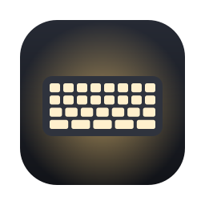
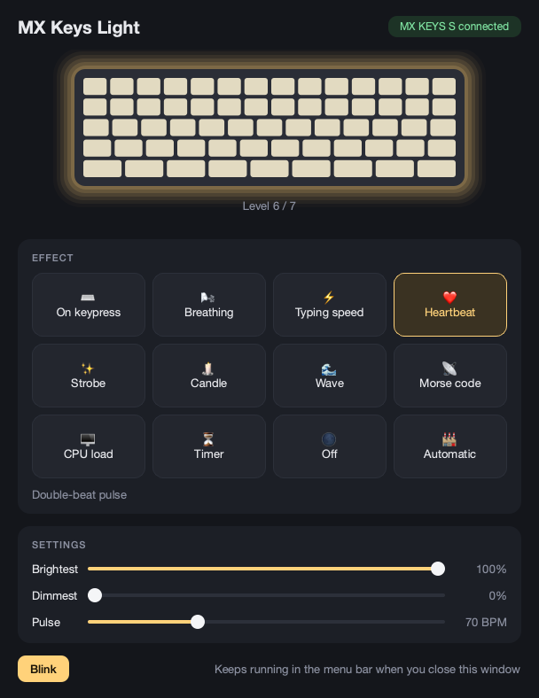

<p align="center"></p>

# MX Keys Light — backlight effects for Logitech MX Keys S

A small macOS menu bar app that drives the backlight of the **Logitech MX Keys S** over Bluetooth:
breathing, heartbeat, candle flicker, Morse code, typing-reactive light and more.
It talks to the keyboard directly (HID++ 2.0), so **Logi Options+ is not required** — and it does not
conflict with it if you have it installed.

<p align="center"></p>

> Not affiliated with or endorsed by Logitech. Use at your own risk.

## Effects

| Effect | What it does |
|---|---|
| ⌨️ On keypress | Lights up on every key, then fades |
| 🌬️ Breathing | Slowly fades in and out |
| ⚡ Typing speed | The faster you type, the brighter |
| ❤️ Heartbeat | Double-beat pulse (adjustable BPM) |
| ✨ Strobe | Fast dim ↔ bright |
| 🕯️ Candle | Random flicker |
| 🌊 Wave | Ramps up slowly, drops at once |
| 📡 Morse code | Blinks any text you type in Morse |
| 🖥️ CPU load | The busier the CPU, the brighter |
| ⏳ Timer | Fades over a set time, blinks when done |
| 🌑 Off / 🏭 Automatic | Backlight off / the keyboard's own sensor mode |

The MX Keys S backlight is a **single white zone with 7 brightness steps** — there is no per-key or
colour control in the hardware, so all effects animate the whole keyboard's brightness.

## Install

1. Download `MX-Keys-Light-<version>-macos-arm64.zip` from the
   [latest release](https://github.com/srkanyalcinkaya/mxkeys-backlight-fx/releases/latest) and unzip it.
2. Move **MX Keys Light.app** to `/Applications`.
3. The app is not notarized by Apple, so the first launch needs one extra step — either
   right-click the app → **Open** → **Open**, or run:
   ```sh
   xattr -dr com.apple.quarantine "/Applications/MX Keys Light.app"
   ```
4. Launch it. A keyboard icon appears in the menu bar.

The prebuilt app is for **Apple Silicon** Macs. On Intel Macs, [run from source](#run-from-source).
The interface is in English or Turkish, following your system language.

### Permissions

- **Input Monitoring** (required): macOS asks for it on first launch. If the window shows
  “No access to the keyboard”, click **Open Settings**, turn on *MX Keys Light* under
  System Settings → Privacy & Security → Input Monitoring, then quit and reopen the app.
  This is what lets the app talk to the keyboard over Bluetooth.
- **Accessibility** (optional): only *On keypress* and *Typing speed* need it, to count key presses.
  Only the fact that a key was pressed is counted — which key it was is never read or stored.

## Using it

- Pick an effect in the window or from the **menu bar icon**. Each effect shows only its own settings.
- **Closing the window does not quit the app** — it keeps running in the menu bar. Quit from the menu.
- The menu also has brightness presets, a blink button and **Start at login**.
- Your last effect and settings are remembered.
- When you quit, the keyboard is returned to its normal automatic mode.
- **Battery saver:** after 5 minutes without any keyboard or mouse input the effect pauses and the
  keyboard goes back to its own automatic mode, so it can sleep. It resumes when you return.

### Remote control

While the app is running it listens on `localhost:8765`, which makes the keyboard a handy notifier:

```sh
npm run build && curl -s localhost:8765/blink?n=3      # blink when a build finishes
curl -s localhost:8765/effect?name=breath              # react breath speed heart strobe candle saw morse cpu timer off auto
curl -s localhost:8765/show                            # open the window
curl -s localhost:8765/quit                            # quit
```

## Run from source

```sh
git clone https://github.com/srkanyalcinkaya/mxkeys-backlight-fx.git
cd mxkeys-backlight-fx
./run.sh            # creates a venv on first run, starts in the background
./run.sh --hidden   # menu bar only
./run.sh --fg       # foreground, for debugging
./run.sh --stop     # quit
```

Requires Python 3.10+. Build the app bundle yourself with `packaging/build.sh <version>`.
Logs go to `~/Library/Logs/mxkeys-backlight-fx/mxlight.log`.

Adding an effect is two small edits in `app.py`: a row in `EFFECTS`, and a branch in
`Engine.compute()` that returns a brightness between 0 and 1.

## How it works (HID++ notes for the MX Keys S)

The keyboard exposes HID++ 2.0 feature `0x1982` (Backlight2, v3) on usage page `0xFF43`.
Things that were not obvious and took a while to find out:

- **hidapi on macOS opens devices exclusively by default**, which fails for a keyboard the system is
  using. Call `hid_darwin_set_open_exclusive(0)` after the first `hid.enumerate()`.
- **The backlight effect must be 0 ("Static").** With effect 1 ("None") the LEDs stay off: levels are
  still stored and reported — even from the keyboard's own brightness keys — but nothing is visible.
  The effect is switched with function 3 (`setBacklightEffect`), which is RAM-only, so the app re-sends
  it periodically.
- **Brightness** is set with function 1 (`setBacklightConfig`): mode 3 (permanent manual) + level 0–7,
  effect byte `0xFF` (unchanged).
- **Level 0 takes about 5 s to apply**, while changes between levels 1–7 are instant. Effects therefore
  use level 1 as their floor; only *Off* sends a real 0.
- **Inactivity timeout**: the keyboard turns the light off 30 s after your hands leave
  (`6 × 5 s`, written in the same config message). The app raises it to 60 min while it runs and
  restores it on quit.
- Status byte of function 2: `00` disabled by software, `02` automatic, `03` automatic / ambient too
  bright, `04` temporary manual (keyboard keys), `05` permanent manual.
- Replies are matched by a per-process software id, so several programs can talk to the keyboard at once.

Idle Bluetooth can delay a command by 1–3 s; while you are typing it is ~50 ms.

## Limitations

- Tested only with an MX Keys S over Bluetooth on Apple Silicon. Other Logitech keyboards that expose
  feature `0x1982` may work, but are untested.
- Keeping the backlight on uses more battery.
- The app is ad-hoc signed, not notarized.

## License

[MIT](LICENSE)

---

### Türkçe

Logitech MX Keys S için macOS menü çubuğu uygulaması: nefes, kalp atışı, mum alevi, mors kodu,
yazmaya tepki veren ışık ve daha fazlası. Sistem diliniz Türkçe ise arayüz Türkçe açılır.
Kurulum: [son sürümden](https://github.com/srkanyalcinkaya/mxkeys-backlight-fx/releases/latest) zip'i indirin,
uygulamayı `/Applications` klasörüne taşıyın, ilk açılışta sağ tık → **Aç** deyin.
Sistem Ayarları → Gizlilik ve Güvenlik → **Giriş İzleme** altında uygulamaya izin verip yeniden açın.
Pencereyi kapatmak uygulamayı kapatmaz; menü çubuğundaki klavye simgesinden kontrol edilir.
